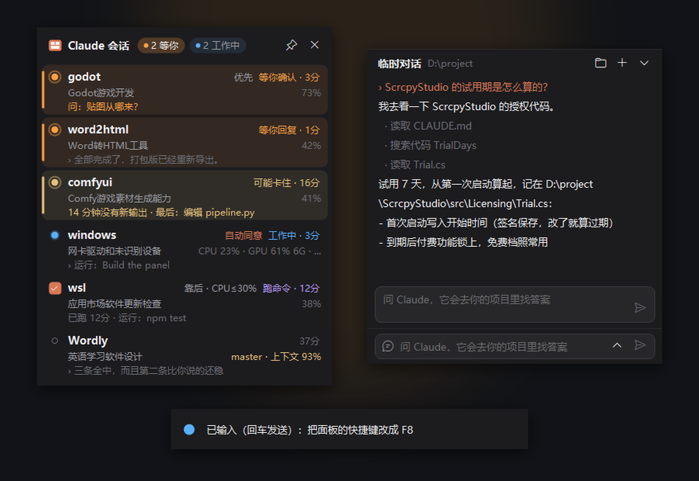
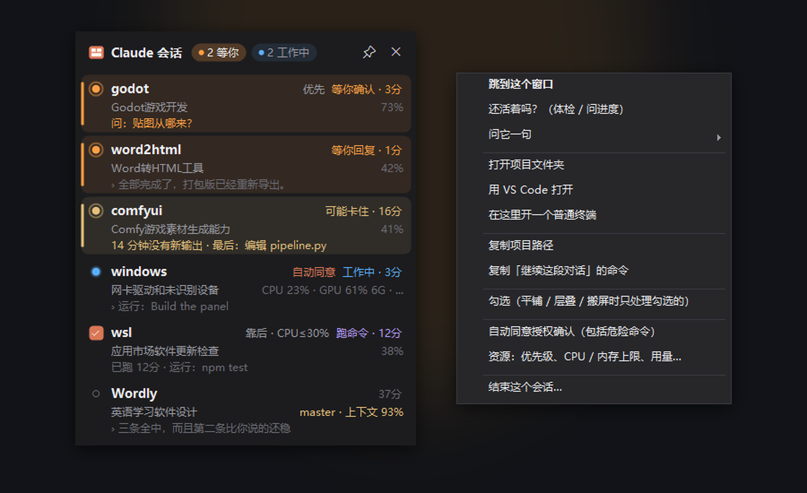
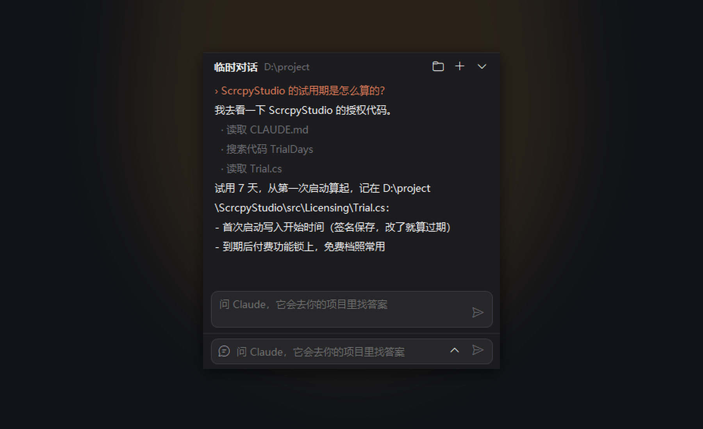
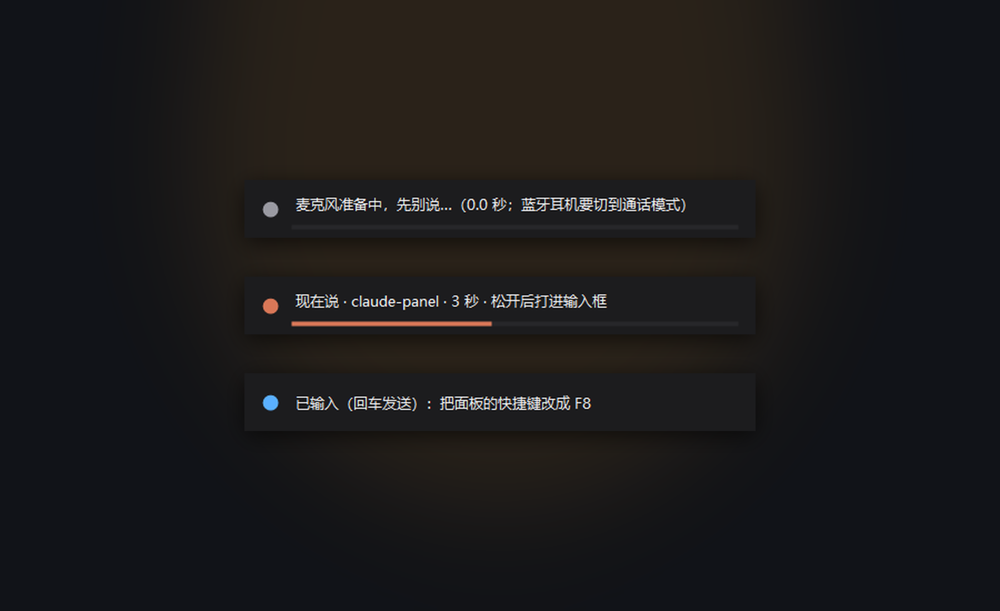

<div align="center">

# 🗂 Claude 会话面板 · ClaudePanel

### 同时开着一堆 Claude Code 终端时用的桌面面板

#### 哪个在等你、哪个卡住了、哪个干完了 —— 一眼看清，一键跳过去

监控每个会话在干什么，一键平铺 / 层叠 / 搬屏；<br>
再通过 Claude Code 的官方扩展接口，把状态栏、安全护栏、语音输入、专用浏览器加进 Claude Code 本身。

**[🌐 访问官网](https://www.lifeisshortplaymore.com/#p/claudepanel)** &nbsp;|&nbsp; **[⬇ 最新版本 · Releases](../../releases/latest)**



<sub>Windows 10/11 · 面板与监控永久免费 · 增强功能 ¥98 买断（2 台电脑）· 首次运行 7 天全功能试用</sub>

</div>

---

## 📖 这是什么

**Claude 会话面板**是给**同时开好几个 Claude Code 终端做开发**的人用的托盘小工具。

窗口一多，问题就来了：哪个在问你问题、哪个干完了你还没看、哪个 15 分钟没动静可能卡住了，
只能一个个切过去看。面板把它们排成一张表，需要你处理的排在最前，点一下就跳到那个窗口。

1. **监控** —— 每个会话的状态、正在做什么（「编辑 PanelForm.cs」「运行：npm test」「问：贴图从哪来？」）、上下文用了多少。
2. **排列** —— 平铺、层叠、多显示器之间整体搬移，保存命名布局，一键还原。
3. **增强 Claude Code** —— 只用官方提供的扩展方式（状态栏、钩子、技能、MCP），**不修改 Claude Code 程序本身**。

> 它不替代 Claude Code，也不调 API：你照常在终端里用 Claude Code，面板只是让多个会话好管。

---

## ✨ 核心功能

### 👀 监控：谁在等你，一眼看清

| 圆点 / 标签 | 含义 |
|---|---|
| 🔵 工作中 | Claude 在思考或输出 |
| 🟣 跑命令 | 正在执行命令（编译、测试……） |
| 🟠 **等你确认 / 等你回复** | 在问你问题、等你批准，或刚干完活你还没去看 |
| 🟡 **可能卡住** | 工作中，但 10 分钟没有任何新输出 |
| ⚪ 空闲 | 等你输入，你已经看过了 |

- 需要你处理的**排到最前**，托盘出现橙点并弹通知，点通知直接跳过去。
- 「还活着吗？」：本地体检一遍，或者问它一句进度，认出回复后它接着干。
- **额度提醒**：Pro / Max 的 5 小时、7 天额度到 80% / 95% 时提醒，重置后也提醒。
- **手机推送**：离开电脑时，等你回复、卡住、额度快用完推到手机（Bark、ntfy、Server 酱、企业微信、Webhook）。

<div align="center"></div>

### 🪟 排列窗口、多显示器

- **平铺**（3×2 网格，不到 6 个不缩小）、**层叠**（缩在一角，每个露出标题栏），**再点一次换一个角**。
- 多块屏之间**整体搬移**，最大化 / 最小化的窗口也照样搬。
- 保存命名布局，排列之前的样子随时一键还原。新开的会话自动接到平铺后面。
- 面板可以弹出、钉在左右两侧，或钉在屏幕顶部变成一条横条。

### 🛠 增强 Claude Code（官方扩展接口）

- **状态栏**：每个 Claude 窗口下面显示 `◆ 项目 分支* │ 模型 │ 上下文 56% │ 时长 +156 −23 │ 5h 24% 7d 81%`。
- **安全护栏**：`rm -rf`、`git push --force`、`git reset --hard`、格式化、删注册表这类命令，执行前弹出 Claude 自己的确认并写明原因（auto 模式下也拦）。
  **护栏是提醒，不是安全边界** —— 换个写法照样能绕过，我们不假装它是。
- **冲突提醒**：两个会话改同一个文件时双方都会知道，Claude 也会被告知先重新读文件。
- **`/record`、`/handoff`**：把进展记进开发记录、写一份交接说明，方便在新窗口接着做。
- **Ctrl+V 贴图**：截完图直接 Ctrl+V 贴进 Claude（它自己在 Windows 上要按 Alt+V）。

### 💬 临时对话：在所有项目里问 Claude（付费）

<div align="center"></div>

面板最下面一行输入框，临时问一句不用另开终端：「哪个项目用过 sherpa-onnx」「ScrcpyStudio 的试用期怎么算的」。
它先看一份项目地图挑出相关项目，再进去读代码找答案。背后是 Claude Code 官方的 `claude -p`，**用你自己的 Claude 账号和额度**。

### 🎙 语音输入：按住 F8 说话（付费）

<div align="center"></div>

对着 Claude 窗口按住 **F8** 说话，松开后文字打进输入框；按住 **F9** 说完直接发送。
**本机离线识别，不上传声音**：Whisper large-v3（N 卡，每句约 1 秒）+ SenseVoice（CPU）两个引擎同时跑，谁先好用谁。
中文夹英文技术词也认得，还可以自己加词表。模型在「组件」页按需下载，不打进程序里。

### 🌐 Claude 专用浏览器（付费）

让 Claude 真正打开网页：执行 JavaScript、带登录状态、点击、填表、截图。
用的是 **Google 官方的 chrome-devtools-mcp**，所有会话共用一个单独配置的 Chrome，和你平时用的 Chrome 分开。

### 📱 手机 / 网页控制 · 资源管理 · 自动同意（付费）

- **网页控制**：手机浏览器里看完整对话、看终端实时画面，发消息、同意 / 拒绝授权确认（默认只有本机能打开，只建议在家里网络或 Tailscale 里用）。
- **资源**：按会话（含它启动的所有子进程）限 CPU、内存，调优先级；前台的会话自动优先；**GPU 排队**让会话轮流用显卡。
- **自动同意授权确认**：单个会话或全部会话，每次都记进日志，危险命令带 ⚠。

---

## 💰 免费能用到哪，买断买的是什么

**免费档就是一个完整好用的会话面板**，不是残废版；付费买的是**增强功能**。

| | 内容 |
|---|---|
| **永久免费** | 会话监控与通知 · 窗口排列、多屏、布局 · 状态栏、即时提醒、额度提醒 · 安全护栏 · 冲突提醒 · 历史对话、新开会话 · 网页查看会话 |
| **¥98 买断** | 语音输入 · Claude 专用浏览器 · 手机 / 网页控制 · 资源管理（CPU / 内存限制、前台优先）· GPU 排队 · 自动同意 · 临时对话 |

**首次运行有 7 天全功能试用**，到期回落到免费档，并且会明确告诉你哪些功能停了 —— 不会悄悄失效。

一次买断，**永久使用，2 台电脑，后续更新免费**。

### 三种开通方式

都在托盘 →「设置」→「账号与授权」里：

- **账号**（推荐）：在软件里注册登录后购买，扫码付款即开通；或在[官网](https://www.lifeisshortplaymore.com/#p/claudepanel)购买后用同一账号登录。换电脑就把旧的那台踢下线。
- **兑换码**：在官网的兑换页或软件里填码，秒开通。
- **离线**：不方便联网的电脑，把页面上显示的本机设备码发给客服，导入回签的授权文件。

> 开通后**断网照样能用**：授权在本地缓存，离线宽限 30 天；离线授权文件则根本不看网络。

---

## ⬇ 下载

- **Gitee**（国内更快）：[gitee.com/sitg/claude-panel-app](https://gitee.com/sitg/claude-panel-app/releases)
- **GitHub Releases**：[最新版本](../../releases/latest)

就一个 `ClaudePanel.exe`（约 50 MB，自带 .NET 运行时），**不用安装**，双击运行，托盘出现图标。
第一次运行会弹出欢迎窗口，选要不要「增强 Claude Code」和「开机启动」。以后有新版本会在软件里提示更新（更新清单带签名，下载完核对哈希和签名才替换）。

下载后可以核对完整性（与发布页公布的 SHA-256 一致即未被篡改）：

```powershell
Get-FileHash .\ClaudePanel.exe -Algorithm SHA256
```

> 首次运行若弹「未知发布者 / SmartScreen」，点「更多信息 → 仍要运行」。程序用的是**自签名**证书
> （WANWU LAB，尚未购买商用代码签名证书），这只影响「系统认不认识发布者」，不影响程序本身；
> 可以核对上面的 SHA-256 自证未被篡改。

---

## 💻 系统要求

- **Windows 10 / 11（64 位）**
- **Claude Code**（npm 安装或官方安装程序都行），在 Windows Terminal 或普通控制台里运行
- 语音输入：有 N 卡（驱动 580+、显存 3 GB+）用 Whisper，没有就用 SenseVoice（CPU）
- 专用浏览器：需要装 Google Chrome

---

## ❓ 常见问题

**Q：会改我的 Claude Code 吗？**<br>
不改程序本身。开「增强 Claude Code」时会往 `~\.claude\settings.json` 加状态栏和钩子（改之前先备份，只增删面板自己的条目），
加两个技能 `/record`、`/handoff`。关掉就恢复原样，「完全卸载」也会还原。

**Q：会上传我的代码或对话吗？**<br>
不会。会话状态读的是 Claude Code 本地的记录（只读）；语音在本机识别。联网的只有授权验证、更新检查，以及你自己开的手机推送。
诊断包也不含令牌和对话内容。

**Q：临时对话要另外付 API 费吗？**<br>
不用。它调用的是你电脑上的 Claude Code（`claude -p`），用你自己的 Claude 账号和额度。

**Q：换电脑还能用吗？**<br>
一份买断可在 2 台电脑同时使用，换机在「账号与授权」里把旧设备踢下线即可。

**Q：是开源的吗？**<br>
**不是。Claude 会话面板是专有软件（闭源）**，本仓库只用于发布下载与说明，不含源代码。

**Q：支持 Mac / Linux 吗？**<br>
目前只有 **Windows** 版：窗口排列、控制台、语音这些都直接用的 Windows 接口。

---

## 📜 第三方组件与商标

完整声明随程序分发（托盘 →「设置」→「关于」→「第三方许可」），也放在本仓库的 [THIRD-PARTY-NOTICES.txt](THIRD-PARTY-NOTICES.txt)。

| 组件 | 许可 | 方式 |
|---|---|---|
| .NET 10 运行时 · System.Text.Json 等 | MIT | 打包在 exe 里 |
| [Whisper.net](https://github.com/sandrohanea/whisper.net) · [whisper.cpp](https://github.com/ggml-org/whisper.cpp) | MIT | 包装库在 exe 里，运行库按需下载 |
| [sherpa-onnx](https://github.com/k2-fsa/sherpa-onnx) · ONNX Runtime | Apache-2.0 · MIT | 同上 |
| Whisper large-v3 模型 · SenseVoice 模型 | MIT · FunAudioLLM model-license | 按需下载 |
| NVIDIA cuBLAS / CUDA Runtime | NVIDIA CUDA EULA | 按需下载 |
| [chrome-devtools-mcp](https://github.com/ChromeDevTools/chrome-devtools-mcp) · Node.js | Apache-2.0 · MIT | 按需下载 |

所有组件都没有修改过，按需下载的每个文件都按固定的 SHA-256 校验。

> **与 Anthropic 无关联**：本软件是第三方工具，与 Anthropic 公司**没有从属、赞助或背书关系**。
> "Claude" 和 "Claude Code" 是 Anthropic 的商标，这里只用来说明本软件配合哪个产品使用。

---

<div align="center">

## 会话再多，也一眼看清

### **[⬇ 前往 Releases 下载](../../releases/latest)** · **[🌐 官网](https://www.lifeisshortplaymore.com/#p/claudepanel)**

<sub>© 玩物丧志软件 WANWU LAB</sub>

</div>
